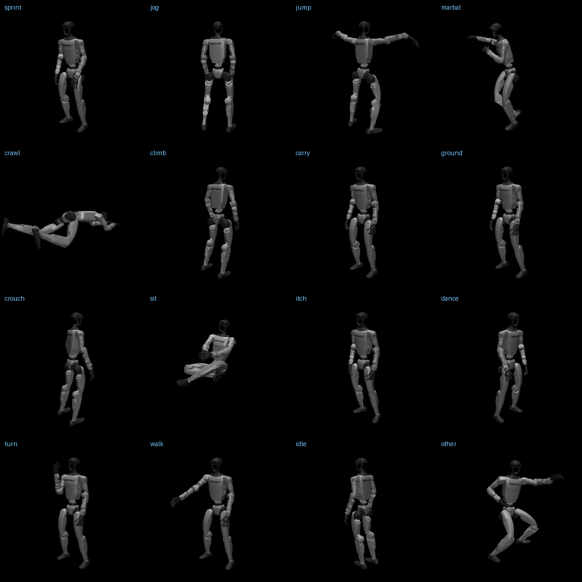
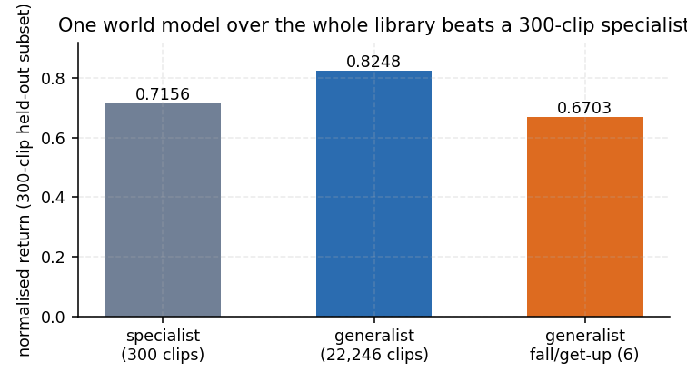
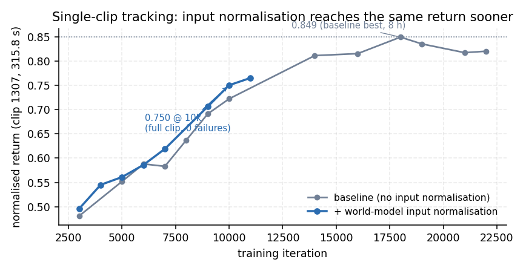
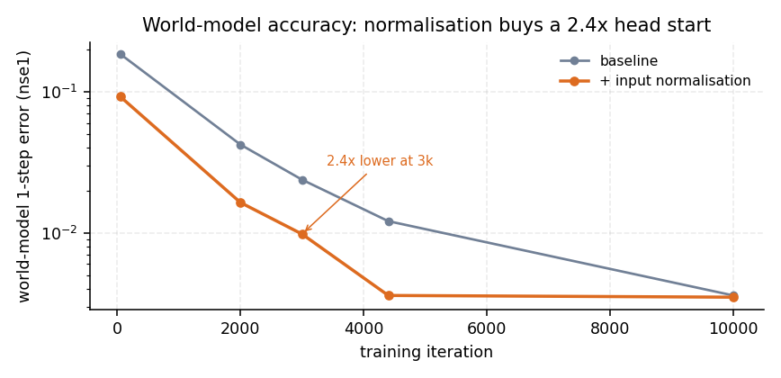
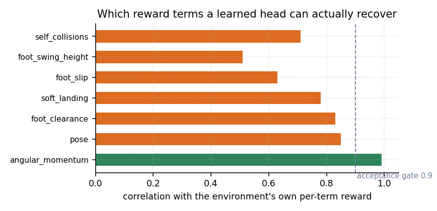
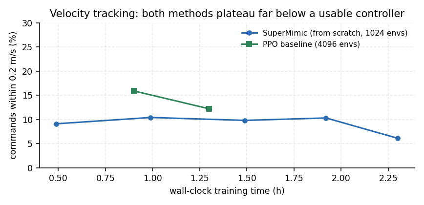

# SuperMimic in mjlab（中文）

[English](README.md) | 简体中文

**SuperMimic: Scaling Humanoid Whole-Body Control with One Differentiable World Model**（CoRL 2026,
[arXiv:2610.28480](https://arxiv.org/abs/2610.28480)）在 Unitree G1 + [mjlab](https://github.com/mujocolab/mjlab) /
MuJoCo Warp 上的复现；并对"如何声明一个 SuperMimic 任务"做了重构，使新增任务变成两行注册而不是新写一个子类。

<p align="center">
  
</p>

<p align="center"><em>同一个策略，<b>16 种不同类型的动作</b>——冲刺、慢跑、跳跃、武术、爬行、爬梯、搬运、倒地起身、下蹲、坐姿、
舞蹈、转身、行走等，每类挑选幅度最大的一条（<code>scripts/pick_grid_clips.py</code>）。每格为 12 秒仿真动作，渲染方式：把策略在仿真中的轨迹回放到 MuJoCo 里（<code>scripts/render_grid.py</code>）。</p>

| 项目 | 结果 |
|---|---|
| **全量库（22,246 条 / 313 h）** | 300 条留出子集 **0.8248**（8 条失败），超过 300 条专用模型（0.7156）；6 条倒地/起身动作 0.6703 |
| **单条动作（clip 1307，315.8 s）** | **0.849** 归一化回报，**15,792 / 15,792 步、零失败**，单张 4090 8 小时 |
| **世界模型** | 1 步归一化误差 **0.0035–0.0047**（论文 0.007–0.011）|
| **任务/训练解耦** | 奖励与终止从 `env.cfg` 反射；解析路径与旧实现**逐项等价到 3.7e-9** |
| **速度追踪** | 已实现论文附录 B 的编码器接口；从零训练与编码器两条路都停在平台（见第 6 节）。论文报告 650/672 条指令 |

---

## 1. 这个仓库做了什么

方法本身是论文的：71 维状态（`qpos 36 | qvel 35`）上的 MLP 世界模型 `s_{t+1} = f(s_t, a_t, ξ)`，
可微的解析奖励/终止头，通过 32 步想象展开的 BPTT 训练动作追踪策略（SHAC 式，无信赖域），小 critic 自举
尾巴，UTD 0.4。

这里的贡献是**任务如何被声明**——这决定了这套方法能不能用到它没写过的任务上：

```python
register_mjlab_task(
    task_id="Mjlab-EE-Tracking-Unitree-G1",
    env_cfg=unitree_g1_motions_all_tracking_env_cfg(),        # 奖励、终止、观测、指令
    play_env_cfg=unitree_g1_motions_all_tracking_env_cfg(play=True),
    rl_cfg=supermimic_runner_cfg(                             # 只有训练超参
        world_model=WorldModelCfg(input_norm=True),
        policy_trainer=PolicyTrainerCfg(batch_size=4096, horizon=32, lr=2e-4),
        schedule=ScheduleCfg(max_hours=8, warmup_iterations=40),
        strict=True,
    ),
    runner_cls=SuperMimicOnPolicyRunner,
)
```

`rl_cfg` 里不出现任何奖励、终止、观测或任务名。任务相关知识全部来自 `env_cfg`，由
`build_wm_spec(env, cfg)` 读取 `env.cfg` 后把每个非零权重奖励项分到三条通道：

| 通道 | 判定 | 处理 |
|---|---|---|
| **analytic** | 该 term 名字在 `adapters/terms/registry.py` 注册了可微实现（追踪 8 项、命令 6 项）| 在预测状态上精确计算，已与环境的数值**逐项比对** |
| **learned** | 无法解析，但环境自己会算（接触力、传感器）| 每项一个小 MLP，用**环境自己算的每项数值**监督，`corr ≥ 0.9` 才允许策略使用，输出限幅 `mean ± 5σ`；未达标期间**策略更新被挂起**，而不是拿代理目标去训练 |
| **unavailable** | 两者都不行 | 打印告警；`strict=True` 时直接拒绝启动 |

启动必打印分类结果：

```
[wm-spec] analytic 8 | learned 0 | dropped 0 | max_step_reward 0.1000
```

解析路径与旧实现**逐项一致**：

```
term                          legacy          spec      max|diff|
motion_global_root_pos    +0.00102955   +0.00102955   0.0e+00
motion_body_pos           +0.01261960   +0.01261960   9.3e-10
motion_body_ang_vel       +0.01371508   +0.01371508   0.0e+00
action_rate_l2            -0.00937071   -0.00937071   0.0e+00
total                     +0.03265205   +0.03265205   3.7e-09
observation 0.0   termination features 0.0   terminated 一致
```

---

## 2. 实验结果

### 2.1 全量库：22,246 条 / 11.34 M 帧 / 313 h

动作库由两个来源重定向而来——**[MotionDecode](https://chingmudata.github.io/MotionDecode/)**（CHINGMU
青瞳视觉与 EnDecodeX 的光学动捕数据系统，也在
[Hugging Face](https://huggingface.co/datasets/CMRobot/MotionDecode) 上发布）与 **KungfuAthlete**，
即 *KungfuAthleteBot*（Lei 等，[arXiv:2602.13656](https://arxiv.org/abs/2602.13656)）构建的高动态武术动作数据集。
两者在第 9 节致谢；数据本身不随仓库分发。

打包成 5.74 GB fp16（含每条的刚体数组），构建耗时 11.6 s。A100 80 GB 单卡、4096 envs、世界模型
2048×10、策略 4096、8.0 h / 25,400 迭代。

<p align="center">
  
</p>

| 评测 | 回报 | 失败 |
|---|---:|---:|
| 300 条留出子集，通用模型（ckpt 22,000）| **0.8248** | 8 / 300 |
| 同一子集，逐条专用模型 | 0.7156 | — |
| 6 条倒地/起身，通用模型 | 0.6703（按步加权 0.5829）| 6 / 6 |
| 论文，BONES-SEED，3 h / 1×H100 | > 0.90 | 25 / 129,514 |

通用模型在同一 300 条上**超过专用模型**，正是论文"算力随库规模缓慢增长"的核心主张。倒地/起身是短板：
22,246 条中 125 条（0.6%）含倒地，论文要到双卡 9.8 h 才把这一类失败归零。

### 2.2 单条动作：clip 1307（315.8 s），1×4090，1024 envs，8 小时

<p align="center">
  
</p>

| 检查点 | 回报 | 完成步数 | 失败 |
|---|---:|---:|---:|
| 18,000 | **0.849** | 15,792 / 15,792 | 0 |
| 19,000 | 0.835 | 15,792 / 15,792 | 0 |
| 22,000 | 0.820 | 261 s 处失败 | 1 |

0.849 检查点的分项：身体朝向 72%、身体位置 91%、根位置 81%、根朝向 97%、线速度 96%、角速度 80%；
世界模型 `nse1 0.0036`、`nse8 0.0055`。**长片上回报会先升后降，务必取最好检查点。**

### 2.3 输入归一化（A/B，同配置，唯一变量）

<p align="center">
  
</p>

| 迭代 | 基线 | **+ 输入归一化** |
|---|---:|---:|
| `nse1` @ 3,000 | 0.0238 | **0.0098**（2.4 倍）|
| `nse1` @ 4,400 | — | 0.0036（基线要 18,000 迭代才达到）|
| benchmark @ 5,000 | 0.552（225 s 处失败）| **0.561（全程零失败）** |
| benchmark @ 7,000 | 0.583 | **0.619** |
| benchmark @ 10,000 | 0.722 | **0.750** |

### 2.4 哪些奖励项能被 learn 出来

<p align="center">
  
</p>

用环境自己算的每项奖励做回归：只有 `angular_momentum` 达到 0.9；`pose`、`foot_clearance`、
`soft_landing`、`foot_slip`、`foot_swing_height`、`self_collisions` 停在 0.5–0.85——它们取决于接触和相位，
不是 `(s, a, ξ)` 的函数。因此**环境与想象同时把它们从奖励里去掉**，这正是 `-SM` 任务的默认行为，
也对应论文删掉自碰撞项的做法。

---

## 3. 目录结构

```text
src/tasks/supermimic/
├── rl/
│   ├── spec.py              # WmTermSpec / RewardCtx / SpecReport —— 任务契约
│   ├── runner.py            # 采集、世界模型拟合、想象、策略/critic 更新
│   ├── mjlab_runner.py      # mjlab runner 适配（asdict rl_cfg、load/save/git log）
│   └── config.py            # SuperMimicCfg：只有训练超参
├── adapters/
│   ├── from_env.py          # build_wm_spec(env, cfg)：把 env.cfg 反射成契约
│   ├── state.py             # EngineStateProvider / MjlabStateProvider
│   ├── terms/               # 解析族（追踪、命令）、学习头、注册表
│   ├── tracking.py          # 引擎原生动作追踪环境
│   └── velocity*.py         # 命令类任务、附录 B 速度编码器
├── configs/example_tasks.py # register_mjlab_task(...) 示例
├── engine/                  # 内置 SuperMimic 引擎（世界模型、heads、想象）
├── data/                    # npz → 打包库、切片、清单
scripts/                     # train / play / evaluate / build_library / seed_buffer
docs/lessons.md               # 完整实验日志：测到了什么、什么失败了
docs/RESULTS.md               # 带日期与全部数字的回溯
```

---

## 4. 快速开始

```bash
# 单条：8 小时、单卡
python scripts/train_tracking.py --adapter tracking --data.npz-dir /path/to/motion_lib_1 \
  --env.num-envs 1024 --env.episode-length-s 20 --env.anchor-obs \
  --schedule.max-hours 8 --run-name one

# 全量库（先打包，再在包上训练）
python scripts/build_library.py --npz-dir /path/to/motions --out data/library_motion
python scripts/train_tracking.py --adapter tracking --data.library data/library_motion \
  --env.num-envs 4096 --env.anchor-obs --schedule.max-hours 8 --run-name library

# 论文附录 F 协议评测 + 交互回放
python scripts/eval_benchmark.py --ckpt logs/one/ckpt_0018000.pt --npz-dir /path/to/motion_lib_1
python scripts/play.py --ckpt logs/one/ckpt_0018000.pt --npz-dir /path/to/motion_lib_1 --num-envs 4
python scripts/play.py --ckpt logs/one/ckpt_0018000.pt --npz-dir /path/to/motion_lib_1 --clip-index 1307
```

引擎自带入口 `python -m supermimic.scripts.train ...`（`PYTHONPATH` 指向 `src/tasks/supermimic/engine`）
接受同样的参数；`scripts/train_tracking.py` 是 mjlab 侧的封装。

长任务用 `systemd-run --user --unit=...`；tmux/setsid 会随 ssh cgroup 一起被杀。

---

## 5. 有限算力下的配置

| 预算 | 配置 | 结果 |
|---|---|---|
| 1×4090 24 GB | 1024 envs，世界模型 1024×8，策略 2048 | 10k 迭代 0.750（约 4 h）；18k 迭代 0.849（约 8 h）|
| 1×A100 80 GB | 4096 envs，世界模型 2048×10，策略 4096 | 全量库 8 h |
| 1×A100 + TF32 | `TORCH_ALLOW_TF32_CUBLAS_OVERRIDE=1` | 每样本更新 1.44 → 0.61 ms |

---

## 6. 什么没有做出来：速度追踪

论文在 §5.5 / 附录 B 评测一个速度控制器：**新编码器** `z = enc_v(proprio_history_930, command_3)`
接**动作追踪的 decoder**，从而继承步态而不是从零探索。本仓库实现了该接口（`Policy.encoders["velocity"]`、
930 维引擎布局历史、3 维指令按 `[2.0, 1.32, 3.35]` 缩放、672 条件步进测试）。实测：

| 配置 | 通过指令 | 现象 |
|---|---:|---|
| PPO 在仿真里（4096 envs，4,000 迭代）| 12.2% | 集长 2.15 s |
| SuperMimic 从零训（3.06 h，62k 迭代）| 6–10% | 学会**平衡**（集长 2.07 → 4.97 s），不跟速度 |
| 附录 B 编码器，decoder **冻结** | 0 / 64 | 0.66 s 就摔：随机编码器给出的 latent 落在 decoder 训练分布之外 |
| 附录 B 编码器，编码器+decoder **联合** | 0 / 64 | 站满整段，完全不跟速度 |
| + 世界模型从追踪 run 热启动 | 崩溃（`nse1 nan`）| 两个任务的 ξ 布局不兼容 |
| + 用录制的走路数据灌回放缓冲 | 崩溃 | 灌入片段与超时复位不连续 |

<p align="center">
  
</p>

天花板是实测出来的：**世界模型对动作的敏感度只有仿真的 11.6%**（`real dv [-0.005, +0.003, -0.199]`
vs `wm dv [-0.003, +0.006, -0.022]`），想象里"迈步"几乎不值钱，而直立项已经拿满 → 站着是共同局部最优。
要跨过这道坎，需要让**一个世界模型贯穿“追踪 → 速度”两个阶段**——编码器应当在一个已经见过走路转移的模型上训练。本仓库尚未实现：跨任务直接热启动会崩，因为两个任务的 ξ 布局不兼容（见第 6 节）。

这里还记录两个测量上的坑（都已修）：误差必须对环境**实际发出的指令**计算（指令是 ±1 m/s 随机重采样，
假设 0.8 m/s 会让 `|v − 0.8|` 失去意义）；不同检查点必须在**同一固定指令序列**上评测（否则同一个 ckpt 能测出 8% 或 16%）。

---

## 7. 设计说明：这个实现的不同之处

只讲自己做了什么，不做横向对比。

**任务是契约，不是子类。** 扩展点就是一个调用：`register_mjlab_task(..., rl_cfg, runner_cls)`。
`rl_cfg` 只装训练超参——没有奖励名、没有终止条件、没有观测、没有任务 id。所有任务相关知识在启动时由
`build_wm_spec(env, cfg)` 从 `env_cfg` 读出，因此新增任务是"注册一个任务"，而不是在训练器里再走一条新代码路径。

**契约是被验证的，不是被声明的。** `tests/test_reward_equivalence.py` 在相同的状态、动作、参考与上下文下
分别求值反射路径与原始解析头，只要任一奖励项、观测帧或终止判定不一致就以非零码退出。当前在真实转移上的
最差奖励差：`3.7e-9`。

**无法求值的奖励会大声报出来。** 每个奖励项必属三类之一：解析（注册了可微投影）、学习（用环境自己算的
每项数值监督，`corr ≥ 0.9` 才启用，输出限幅 `mean ± 5σ`）、不可用（`strict=True` 时拒绝启动）。
每个学习项的相关系数都会打印，所以"删掉某一项"是**可审计的决定**而不是悄悄发生的；未达标期间策略更新被挂起，
而不是拿代理目标去训练。

**世界模型按模块归一化。** 状态特征、动作、ξ 各自维护 running 均值/方差，只由真实转移更新，想象段不更新。
这是本仓库实测收益最大的单点改动（3k 迭代时世界模型误差低 2.4 倍，同检查点回报高 2–6%），成本是三个缓冲。

**行为是被测出来的，包括失败的部分。** §2 与 §6 的每个数字都来自论文附录 F 协议或固定种子的指令扫描；
负结果都附带产生它的测量（世界模型的动作敏感度、本项目自己犯过并修掉的两个测量错误）。

---

## 8. 局限

* **倒地/起身仍是短板**（0.6703，6/6 失败）。论文用双卡 9.8 h 才解决，本仓库未尝试。
* **速度追踪未收敛**（第 6 节）。接口完整且有测试覆盖，结果停在 6–10% 指令。
* **未使用 BONES-SEED**，全量库用的是 22,246 条重定向片段，失败数不与论文的 129,514 条基准直接可比。
* 依赖接触的奖励项无法在想象中求值，一律**从奖励中删除**（第 2.4 节），而不是用代理替代。

---

## 9. 许可与致谢

代码 MIT（以仓库所有者选择为准）。方法来自 Liao 等，*SuperMimic*，CoRL 2026；mjlab、MuJoCo、MuJoCo Warp
按原许可使用。

全量库实验所用的动作数据由两个来源重定向而来，均不随仓库分发：

* **MotionDecode** —— CHINGMU（上海青瞳视觉）与 EnDecodeX 的光学动捕数据系统。主页
  <https://chingmudata.github.io/MotionDecode/>，数据发布于
  [Hugging Face](https://huggingface.co/datasets/CMRobot/MotionDecode)。
* **KungfuAthlete** —— 与职业武术运动员合作构建的高动态武术动作数据集，见
  *KungfuAthleteBot: Learning High-Dynamic Motion from Videos with Unified Robust Recovery*
  （Z. Lei, L. Cao, X. Wang, T. Qian, J. Liu, X. Li，
  [arXiv:2602.13656](https://arxiv.org/abs/2602.13656)，2026）。

单条实验（1307）使用的是同一套重定向动作库中的一条。文中如引用 LAFAN1 重定向数据，其原始动作为 Ubisoft
La Forge 数据（CC BY-NC-ND 4.0），由 Unitree 重定向到 G1。